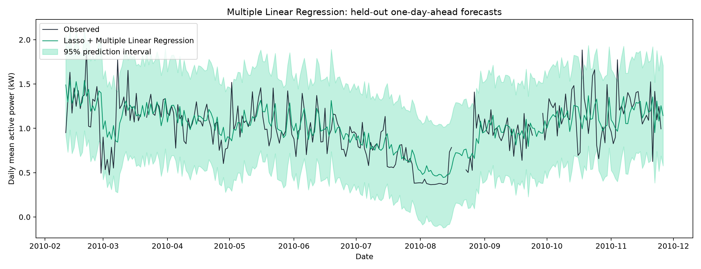
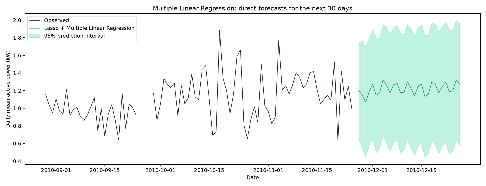

# 家庭用電預測：Lasso + 多元線性回歸（MLR）

## 資料與切分

來源：[Kaggle 家庭用電資料](https://www.kaggle.com/datasets/uciml/electric-power-consumption-data-set)。共 2,075,259 筆分鐘資料；2006-12-16 17:24:00～2010-11-26 21:02:00。
目標為 Global_active_power 每日平均（kW），不是每日用電量（kWh）。每欄每天須有至少 1,296 筆有效分鐘（90%），不足者以過去最後有效日向前填補，不使用未來值。首個有效目標日前移除。
保留 1441 日，目標補值 23 日；補值目標參與訓練，但不當作測試真值。

- 訓練：2006-12-17～2010-02-10，扣除 30 日暖機後 1122 列。
- 測試：2010-02-11～2010-11-26，289 日，其中 276 日可評分。
- 時間順序約 80% / 20%，與原 AR 版本相同日期切分，未隨機打散。

## Lasso 特徵選擇

候選欄位為有功功率、無功功率、電壓、電流及三個分表（Global_active_power, Global_reactive_power, Voltage, Global_intensity, Sub_metering_1, Sub_metering_2, Sub_metering_3）。對每欄建立 [1, 2, 3, 7, 14, 30] 天落後值，共 42 個特徵。每日聚合均取平均，分表仍是平均每分鐘讀值（Wh），不是每日累計。
只使用預測日前已知的歷史資料，不使用待預測當日的電流或電壓。目標歷史值也可作為其中一組解釋變數。
訓練期內以 5 折擴展視窗交叉驗證、MSE 選 alpha；50 個候選值為 0.0001～1 的對數等距值。每折獨立擬合 StandardScaler，再進行 Lasso（L1）。

- 最佳 alpha：0.01599859。
- CV 平均 MSE：0.074880 kW²（此為 Lasso 選擇階段，非最終 MLR 的 CV 分數）。
- 選出 10 個特徵。

## 多元線性回歸

使用選中特徵，以 statsmodels OLS 無正則化最小平方法重新估計多元線性回歸：ŷ = β₀ + β₁x₁ + … + βₚxₚ；截距為 -1.127095。
此版本以多種用電變數作為解釋變數，未使用 AutoReg。Lasso 係數對應標準化特徵，MLR 係數對應各欄原始尺度，不能直接拿係數大小比較重要性。

| 特徵 | Lasso 係數 | MLR 係數 |
|---|---|---|
| Global_active_power_lag_1 | 0.159195 | 0.433819 |
| Global_active_power_lag_3 | 0.070068 | 0.169896 |
| Global_active_power_lag_7 | 0.071263 | 0.162699 |
| Global_active_power_lag_14 | 0.038743 | 0.067643 |
| Global_reactive_power_lag_2 | -0.016078 | -0.808940 |
| Global_reactive_power_lag_30 | -0.010671 | -0.520577 |
| Voltage_lag_2 | 0.003894 | 0.006058 |
| Sub_metering_1_lag_14 | 0.012395 | 0.024341 |
| Sub_metering_2_lag_1 | -0.024267 | -0.035503 |
| Sub_metering_3_lag_2 | 0.005582 | 0.004879 |

## 測試指標

固定訓練係數，逐日預測下一日；每次可使用之前日期已揭露的實測值或因果補值。這不是在測試期起點一次預測整段。基準使用相同有效評分日期。

| 指標 | Lasso + MLR | 前一天基準 | 前一週同日基準 |
|---|---|---|---|
| MSE (kW²) | 0.0559 | 0.0771 | 0.1092 |
| RMSE (kW) | 0.2363 | 0.2777 | 0.3304 |
| MAE (kW) | 0.1733 | 0.1993 | 0.2447 |
| R² | 0.4027 | 0.1753 | -0.1674 |
| MAPE (%) | 19.6626 | 20.0981 | 27.2201 |
| sMAPE (%) | 17.8777 | 19.2737 | 24.8241 |
| 誤差在 ±10% 內 (%) | 39.8551 | 38.4058 | 30.0725 |
| 95% 區間覆蓋率 (%) | 97.4638 | — | — |
| 平均區間寬度 (kW) | 1.1348 | — | — |

MSE、RMSE、MAE 越小越好；R² 越高越好，負值代表比測試集均值參考更差。MAPE = 平均 |誤差/真值| × 100%；sMAPE = 平均 2|誤差|/(|真值|+|預測|) × 100%。
回歸沒有分類準確率，此處明確以「|誤差| ≤ |真值| × 10%」的比例表示準確率，不採 100%−MAPE。

95% 預測區間使用 OLS 的 obs_ci_lower / obs_ci_upper，形式為 ŷ ± t₀.₉₇₅,df √(殘差變異 + xᵀ Cov(β) x)。包含新觀測誤差與係數估計誤差，不是平均值信賴區間。假設誤差常態、同方差且獨立；未涵蓋 Lasso 特徵選擇的不確定性，時間序列可能違反假設，應搭配實測覆蓋率判讀。負下界未截斷。

## 資料結束後 30 天預測

凍結訓練期選中的特徵，用全部歷史資料為各個預測步長 h=1～30 分別擬合 MLR：以日期 t 之前的特徵預測 t+h−1 的有功功率。每個模型只使用已知標籤的歷史配對，全部從資料終點的同一組已知歷史特徵出發。
這是直接多步預測，不需要假設未來電壓、電流與分表值。未來各步長未另做回測，測試指標只代表一步預測；這 30 天沒有真值，不能計算準確率。
每個區間是該步長 OLS 的邊際 95% 預測區間，不是整條 30 日路徑同時有 95% 覆蓋。日期由資料終點推進，並非目前日期。

| 日期 | 預測 (kW) | 95% 下界 | 95% 上界 |
|---|---|---|---|
| 2010-11-27 | 1.2002 | 0.6550 | 1.7454 |
| 2010-11-28 | 1.1491 | 0.5386 | 1.7596 |
| 2010-11-29 | 1.0688 | 0.4469 | 1.6907 |
| 2010-11-30 | 1.1906 | 0.5816 | 1.7995 |
| 2010-12-01 | 1.2719 | 0.6522 | 1.8915 |
| 2010-12-02 | 1.1467 | 0.4960 | 1.7974 |
| 2010-12-03 | 1.1747 | 0.5510 | 1.7983 |
| 2010-12-04 | 1.3247 | 0.7014 | 1.9480 |
| 2010-12-05 | 1.2594 | 0.5965 | 1.9224 |
| 2010-12-06 | 1.1724 | 0.5124 | 1.8324 |
| 2010-12-07 | 1.2657 | 0.6228 | 1.9087 |
| 2010-12-08 | 1.2855 | 0.6343 | 1.9366 |
| 2010-12-09 | 1.1749 | 0.4981 | 1.8517 |
| 2010-12-10 | 1.1810 | 0.5263 | 1.8357 |
| 2010-12-11 | 1.2979 | 0.6521 | 1.9437 |
| 2010-12-12 | 1.2251 | 0.5469 | 1.9033 |
| 2010-12-13 | 1.1397 | 0.4652 | 1.8142 |
| 2010-12-14 | 1.2421 | 0.5764 | 1.9079 |
| 2010-12-15 | 1.2748 | 0.6021 | 1.9474 |
| 2010-12-16 | 1.1327 | 0.4405 | 1.8250 |
| 2010-12-17 | 1.1611 | 0.4929 | 1.8293 |
| 2010-12-18 | 1.3020 | 0.6359 | 1.9680 |
| 2010-12-19 | 1.2680 | 0.5812 | 1.9548 |
| 2010-12-20 | 1.1751 | 0.4867 | 1.8636 |
| 2010-12-21 | 1.2461 | 0.5690 | 1.9233 |
| 2010-12-22 | 1.2932 | 0.6092 | 1.9772 |
| 2010-12-23 | 1.1886 | 0.4864 | 1.8908 |
| 2010-12-24 | 1.1958 | 0.5130 | 1.8787 |
| 2010-12-25 | 1.3207 | 0.6450 | 1.9965 |
| 2010-12-26 | 1.2729 | 0.5776 | 1.9682 |

## 重現與檔案

在 hw_c 目錄執行：`.venv/Scripts/python.exe multiple_linear_regression/0.py`。
共用上層虛擬環境及資料快取；獨立安裝可使用本資料夾的 requirements.txt。可指定 `--data` 與 `--output`。

- [Lasso 特徵](lasso_features.csv)、[CV 結果](lasso_cv.csv)、[MLR 係數](mlr_coefficients.csv)
- [測試預測](test_predictions.csv)、[未來預測](future_predictions.csv)、[各步長係數](future_model_coefficients.csv)
- [指標 JSON](metrics.json)、[每日資料](daily_data.csv)

限制：僅單一時間切分；每日聚合不保留日內尖峰，缺失補值可能低估變異；電流與有功功率等欄位可能共線，係數不代表因果關係。與 AR 版本相比，候選特徵也已改變，結果差異不能只歸因於估計器。
