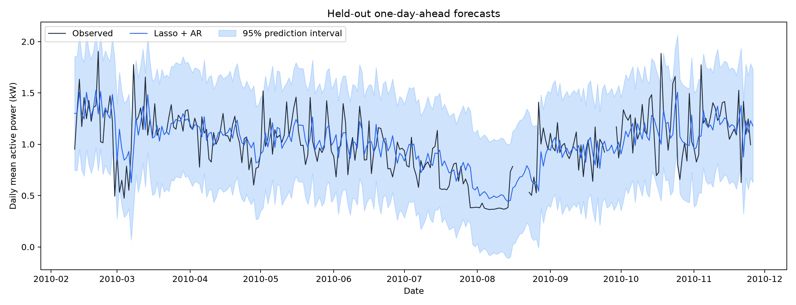
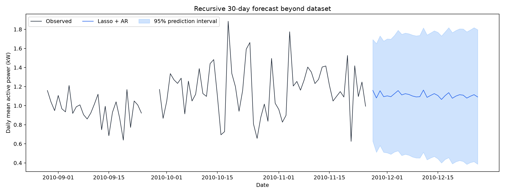

# 家庭用電預測：Lasso 特徵選擇 + AR

## 資料與預測設定

來源：[Kaggle](https://www.kaggle.com/datasets/uciml/electric-power-consumption-data-set)、[UCI 原始說明](https://archive.ics.uci.edu/dataset/235/individual+household+electric+power+consumption)。
原始 2,075,259 筆，時間 2006-12-16 17:24:00～2010-11-26 21:02:00，有功功率缺失 25,979 筆。

未指定目標與頻率，因此採用 Global_active_power 的每日平均（kW），不是每日用電量（kWh）。每日至少 1,296 個有效分鐘（完整日 90%）才視為有效觀測，其餘日以之前最後有效日補值作為輸入，不使用未來資訊；首個有效日前移除。
保留 1441 日，其中 23 日補值。補值日參與訓練，但不作為測試真值；這可能使訓練變異偏低。

- 訓練：2006-12-17～2010-02-10，1152 日，扣除 lag 後 1122 列。
- 測試：2010-02-11～2010-11-26，289 日，實際評分 276 日。
- 依時間約 80% / 20% 切分，不隨機打散。

## Lasso 特徵選擇與 AR 模型

純 AR 使用目標本身的歷史值，候選特徵是 lag 1～30 天，不使用同日電流或分表讀值作為已知未來資料。
Lasso 使用 L1 正則化，訓練期內採 5 折擴展視窗交叉驗證，依 MSE 從 50 個 0.0001～1 的對數等距 alpha 中選擇。StandardScaler 在每折訓練部分獨立擬合，避免驗證資訊洩漏。

- 最佳 alpha：0.01325711。
- CV 平均 MSE：0.072649 kW²。
- 選中 14 個 lag：[1, 3, 4, 6, 7, 8, 9, 13, 14, 17, 21, 23, 26, 28]。
- 選完後以 statsmodels AutoReg 做無正則化最小平方法估計；模型為 ŷₜ = 截距 + Σ φₖ yₜ₋ₖ，截距 0.087010。

Lasso 係數對應標準化特徵；最終 AR 係數對應原始 kW 尺度。

| 落後天數 | Lasso 係數 | AR 係數 |
|---|---|---|
| 1 | 0.138413 | 0.379395 |
| 3 | 0.052573 | 0.127040 |
| 4 | 0.040661 | 0.128998 |
| 6 | 0.018683 | 0.077613 |
| 7 | 0.061098 | 0.164093 |
| 8 | -0.014850 | -0.121761 |
| 9 | -0.011537 | -0.073385 |
| 13 | 0.013489 | 0.076765 |
| 14 | 0.035871 | 0.084723 |
| 17 | 0.003545 | 0.022846 |
| 21 | 0.031341 | 0.101614 |
| 23 | -0.003360 | -0.056426 |
| 26 | -0.001316 | -0.055816 |
| 28 | 0.012347 | 0.064327 |

## 評估指標

測試為逐日一步預測：固定訓練所得係數，每天使用之前日期已觀測值或因果補值。不是在測試期起點一次預測整段未來。基準模型使用相同有效日期評分。

| 指標 | Lasso + AR | 前一天基準 | 前一週同日基準 |
|---|---|---|---|
| MSE (kW²) | 0.0562 | 0.0771 | 0.1092 |
| RMSE (kW) | 0.2371 | 0.2777 | 0.3304 |
| MAE (kW) | 0.1757 | 0.1993 | 0.2447 |
| R² | 0.3990 | 0.1753 | -0.1674 |
| MAPE (%) | 19.9544 | 20.0981 | 27.2201 |
| sMAPE (%) | 18.3098 | 19.2737 | 24.8241 |
| 誤差在 ±10% 內 (%) | 35.8696 | 38.4058 | 30.0725 |
| 95% 區間覆蓋率 (%) | 96.3768 | — | — |
| 平均區間寬度 (kW) | 1.1068 | — | — |

MSE、RMSE、MAE 越小越好；R² 越大越好，負值代表比測試集均值參考更差。
MAPE = 平均 |誤差/真值| × 100%；sMAPE = 平均 2|誤差|/(|真值|+|預測|) × 100%。
回歸沒有分類 accuracy，本報告將「準確率」定義為 |誤差| ≤ |真值| × 10% 的比例，不使用 100%−MAPE。
本次 AR 的 RMSE **優於**兩個基準中較佳者；Lasso 不保證預測一定改善。

## 測試圖與 95% 預測區間

區間針對新觀測值，並非平均值的信賴區間。單步區間使用 ŷ ± 1.96 √(殘差變異 + xᵀ Cov(β) x)，包含係數估計與觀測誤差，未納入特徵選擇的不確定性。
假設殘差近似常態、同方差且無自相關；實際資料未必符合，請以上表實測覆蓋率判讀，不保證達到 95%。未將負下界截斷。

## 資料結束後 30 天預測

保留訓練期選中的 lag，用所有歷史資料重新擬合 AR，遞迴預測 30 天。日期由資料終點推進，不代表目前日期的用電預測；無未來真值，不能計算未來準確率。
此處 AutoReg 多步區間包含創新誤差的遞迴傳播，但視係數為固定，不包含係數估計與特徵選擇不確定性，與前述單步區間方法不同。

| 日期 | 預測 (kW) | 95% 下界 | 95% 上界 |
|---|---|---|---|
| 2010-11-27 | 1.1598 | 0.6270 | 1.6925 |
| 2010-11-28 | 1.0806 | 0.5110 | 1.6502 |
| 2010-11-29 | 1.1563 | 0.5816 | 1.7309 |
| 2010-11-30 | 1.0941 | 0.5117 | 1.6765 |
| 2010-12-01 | 1.1025 | 0.5055 | 1.6995 |
| 2010-12-02 | 1.0937 | 0.4906 | 1.6969 |
| 2010-12-03 | 1.1257 | 0.5149 | 1.7365 |
| 2010-12-04 | 1.1579 | 0.5262 | 1.7895 |
| 2010-12-05 | 1.1127 | 0.4776 | 1.7477 |
| 2010-12-06 | 1.1254 | 0.4903 | 1.7605 |
| 2010-12-07 | 1.1171 | 0.4807 | 1.7534 |
| 2010-12-08 | 1.1008 | 0.4621 | 1.7395 |
| 2010-12-09 | 1.0916 | 0.4522 | 1.7311 |
| 2010-12-10 | 1.0939 | 0.4513 | 1.7364 |
| 2010-12-11 | 1.1632 | 0.5119 | 1.8145 |
| 2010-12-12 | 1.0867 | 0.4327 | 1.7408 |
| 2010-12-13 | 1.1072 | 0.4523 | 1.7621 |
| 2010-12-14 | 1.1260 | 0.4675 | 1.7844 |
| 2010-12-15 | 1.1061 | 0.4434 | 1.7687 |
| 2010-12-16 | 1.0648 | 0.3998 | 1.7298 |
| 2010-12-17 | 1.1050 | 0.4367 | 1.7733 |
| 2010-12-18 | 1.1361 | 0.4550 | 1.8171 |
| 2010-12-19 | 1.0775 | 0.3904 | 1.7647 |
| 2010-12-20 | 1.1003 | 0.4125 | 1.7882 |
| 2010-12-21 | 1.1148 | 0.4248 | 1.8047 |
| 2010-12-22 | 1.1098 | 0.4160 | 1.8036 |
| 2010-12-23 | 1.0792 | 0.3850 | 1.7735 |
| 2010-12-24 | 1.0990 | 0.4039 | 1.7941 |
| 2010-12-25 | 1.1152 | 0.4133 | 1.8170 |
| 2010-12-26 | 1.0912 | 0.3865 | 1.7958 |

## 重現與輸出檔

在專案目錄執行 `.venv/Scripts/python.exe 0.py`。其他 Python 環境先執行 `python -m pip install -r requirements.txt`，再執行 `python 0.py`。
優先使用專案 `.tools/data/household_power_consumption.txt` 快取；無快取時下載 Kaggle 資料，亦可指定 `--data 本機household_power_consumption.txt路徑`。

- [每日資料](daily_data.csv)
- [Lasso 係數](lasso_features.csv)、[交叉驗證結果](lasso_cv.csv)
- [測試預測](test_predictions.csv)、[未來預測](future_predictions.csv)、[評估 JSON](metrics.json)

限制：每日聚合無法保留日內尖峰；僅考慮 30 天內歷史值，未明確建模年季節性、天氣或假日；評估為單一時間切分，指標只描述此測試期間。
